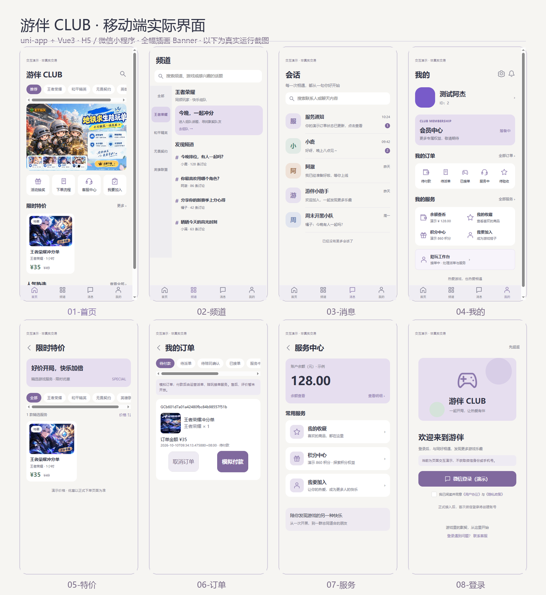
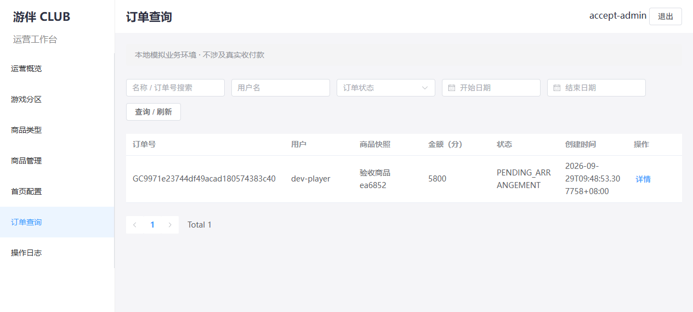

# 🎮 GamesClub — 游戏陪玩俱乐部系统

一个面向**游戏陪玩俱乐部**的客户服务与内部管理系统：客户用**微信小程序**浏览游戏、下单预约、付款；运营与管理员用 **Web 后台**管理游戏、商品、首页配置和订单。两端共用同一套 **Python 后端** 和 **PostgreSQL** 主数据库，账号、订单、商品不维护双份真值。

> 当前进度（2026-10-16）：已接入真实微信登录、订单与派单、模拟售后结算、订单私信与站内客服；客服确认接单人、陪玩开始及申请完成、客户同意后完成。新增频道公开图文动态、点赞评论、游戏陪玩榜单，以及提交订单页内的选择陪陪底部弹窗。仍属本地开发验证阶段，支付/退款未接真实资金，未部署生产。本次频道与弹窗尚未微信真机验收。
>
> 发布需要做什么、哪些代码可复用，见 [正式发布准备与差距评估](./notices/正式发布准备与差距评估.md)。当前功能详见 [PROJECT_OVERVIEW.md](./PROJECT_OVERVIEW.md)，历史完成记录不等于正式发布验收。

---

## ✨ 已完成的功能

### 1. 客户小程序（uni-app + Vue 3 + TypeScript）

温和配色（暖白 / 浅灰紫 / 柔和绿）的八页设计已落地为可交互页面，并接入真实后端：

| 页面 | 功能 |
| --- | --- |
| 首页 | 游戏分区筛选、商品搜索、轮播 / 特价 / 人气配置（全幅插画 banner 轮播）、四快捷入口 |
| 频道 | 各游戏分区公开图文动态、点赞、评论；近30天完成接单热度榜／累计完成接单榜，前三名及完整排名 |
| 消息 | 订单私信与客服咨询统一列表、统一搜索、按最近消息排序；未读及待回复标记 |
| 提交订单 | 商品与角色资料、留言、意向陪玩；游戏平台遵循商品配置；页内底部弹窗按名称／ID 搜索、头像及总接单信息、选择回填 |
| 商品详情 | 服务端商品详情、封面、数量范围、下单 |
| 订单 | 下单资料、客服派单、陪玩服务、用户验收（待付款→待派单→已接单→服务中→待验收→已完成）、付款 / 取消 / 验收、**已完成订单评价（一单一评）**、**售后申请及退款结果**；横排操作按钮、付款后返回首页、显示期间自动刷新 |
| 我的 | 收藏、服务、登录态管理；独立陪玩工作台按用户决定取消，改为客服线下协调与后台登记，客服确认实际人选，陪玩在订单会话开始/申请完成，客户最终验收 |
| 登录 | **真实微信登录**（`uni.login` → 后端 `code2session` 换 openid）+ 昵称 / 头像填写 |
| 陪玩入驻 | 申请与管理员审核接口已实现；首发前核验端内入口与完整履约流程 |

历史移动端 8 页截图（不代表最新频道/提交订单界面；`design/shots/` 为源图，P2 手绘设计基准保留在 `design/*.svg`）：



### 2. 管理后台 Web（Vue 3 + Element Plus）

独立管理端，覆盖运营日常操作，关键订单和目录写操作带审计与版本冲突保护：

- **登录 / 概览**：Session + CSRF 认证，数据看板
- **游戏 / 类型 / 商品**：增删改查、图片上传（服务端重新编码）、上下架、停用、**一键投放首页**（新增/编辑商品时直接勾选轮播/特价/人气，自动同步首页配置，无需重复新增）
- **首页配置**：轮播 / 特价 / 人气条目编排
- **订单**：查询/人工建单，未付款订单编辑/删除；客服确认接单；陪玩在会话开始及申请完成，客户最终验收（版本/权限/游戏归属/预约冲突检查）
- **陪玩**：入驻申请审核（通过 / 驳回）、陪玩档案管理（绑分区 + 接单开关 + 编辑 / 删除，有未完成订单时删除受保护）
- **售后复核**：售后案件列表与复核（通过建预留退款 / 驳回）、展示申请原因与复核说明、模拟退款执行（成功 / 失败 / 未知）；已付款未开始取消退款已有后端接口，尚无专用页面
- **结算**：发起结算批次（订单过售后时限且无处理中售后 / 退款才可结算，锁单 + 整数分抽成 + 陪玩收益分成）
- **客服会话**：用户、陪玩与客服双向文字沟通，共享收件箱、未读／待回复筛选；业务列表显示期间每 5 秒自动更新
- **客服配置**：站内客服可直接使用；微信原生／企业微信为额外渠道，仅超级管理员可配置
- **抽成与售后配置**：统一抽成比例（基点）、售后时限（小时）全局配置（仅超级管理员）
- **审计日志**：关键写操作全程留痕（不记录密码与 Token）



### 3. 统一后端（Django 5 + DRF + PostgreSQL）

- 多游戏分区、服务商品、账号与角色权限模型
- 订单：服务端订单号、金额快照、**8 态状态机**、幂等键（`Idempotency-Key`）并发保护
- 陪玩：入驻申请、档案、客服确认实际接单人、订单会话内开始 / 申请完成、客户确认履约
- **评价**：订单完成后一单一评（`Review` 模型 OneToOne 订单）
- **售后**：售后案件（`AfterSaleCase`）、图片凭证上传接口（鉴权私有下载与端内上传界面待完善）、退款（`Refund`）、管理员复核；售后窗口可配置
- **结算**：结算批次（`Settlement`）+ 明细（`SettlementItem`），`select_for_update` 锁单、整数分抽成（`commission_bp`）、陪玩收益分成；历史订单回填 20% 抽成
- 收藏、模拟付款、退出撤销 Token
- 公开社区图文、点赞、评论持久化，作者删除与管理员隐藏；按游戏的完成订单数生成榜单
- 版本冲突检测（409）、修改前后日志、`X-Request-ID` 请求追踪
- **真实微信登录**：`WechatIdentity` 模型 `(appid, openid)` 唯一归并，AppSecret 仅存服务端 `.env`

---

## 🏗️ 技术架构

```
┌─────────────────────┐        ┌─────────────────────┐
│  客户微信小程序       │        │  运营/管理 Web 后台    │
│  uni-app · Vue3 · TS │        │  Vue3 · Element Plus │
└──────────┬──────────┘        └──────────┬──────────┘
           │  Bearer Token                │  Session + CSRF
           └──────────────┬───────────────┘
                          ▼
              ┌───────────────────────┐
              │   Python 后端 (Django 5 + DRF)  │
              │  core 单 app · 统一业务逻辑      │
              │  · 商品 / 订单 / 收藏 / 登录      │
              │  · 版本冲突 / 幂等 / 审计 / 微信   │
              └───────────┬───────────┘
                          ▼
              ┌───────────────────────┐
              │   PostgreSQL 17 (Docker)  │
              └───────────────────────┘
```

- **小程序**与**后台**共用同一业务后端与数据库，金额、状态、版本同源
- 管理端走 `Session + CSRF`，小程序走 `Bearer Token`，微信登录走 `code2session`

---

## 🚀 快速开始

> 详细步骤与验收边界见 [《第三阶段完成度与联调手册》](./第三阶段完成度与联调手册.md)。

### 后端

```powershell
cd backend
python -m pip install -r requirements.txt
docker compose up -d db                 # 启动 PostgreSQL 17
copy .env.example .env                  # 配置 DATABASE_URL / 微信 AppID 等
python manage.py migrate
python manage.py seed_demo              # 首次空库补示例数据
python manage.py createsuperuser        # 创建后台管理员
python manage.py runserver 127.0.0.1:8000
```

### 管理后台

```powershell
cd apps/admin
pnpm install
pnpm dev                                 # http://127.0.0.1:5174
```

### 小程序

```powershell
cd apps/miniapp
pnpm install
pnpm build:mp-weixin                     # 产物 dist/build/mp-weixin
# 微信开发者工具导入 dist/build/mp-weixin，填入 AppID
```

---

## 🧪 验收情况

| 项 | 结果 |
| --- | --- |
| 后端测试 | 2026-10-16 全量136项通过，见 [客服与履约联调](./notices/客服互通与售后联调说明.md)；包含频道、原订单/支付/派单/售后/结算和私信回归 |
| 前端单测 | 小程序 3 项（domain）+ 管理端 4 项（api），Node 内置 `node:test` 零依赖 |
| 类型检查 | 小程序 + 管理端 `type-check` 全过 |
| 手动双端验收 | 当前已验证多角色履约、客服双向文字、自动同步、驳回重提及通过退款；历史第三阶段另有23项 API 断言 |
| UI 验收 | 当前 H5 验证390px订单横排按钮、客服与订单统一列表及搜索；历史截图位于 `notices/e2e-screenshots/`，最新本地产物在被忽略的 `test-results/` |
| 真实微信登录 | 已有开发者工具真实 code2Session 联调记录；本次新增界面尚未真机验收 |
| CI | GitHub Actions 三任务流水线（后端 + 小程序 + 管理端） |

验收证据与报告见 [`notices/`](./notices/)，P4 设计与实施见 [`notices/P4-订单与派单服务设计.md`](./notices/P4-订单与派单服务设计.md)，P5 设计见 [`notices/P5-售后结算评价设计.md`](./notices/P5-售后结算评价设计.md)，API 层可复跑 `python notices/e2e_verify.py`。

---

## 📁 目录结构

```
gamesclub/
├── apps/
│   ├── miniapp/          # 客户小程序（uni-app + Vue3 + TS）
│   └── admin/            # 管理后台 Web（Vue3 + Element Plus）
├── backend/              # Django 5 + DRF 统一后端
│   ├── core/             #   业务逻辑（模型/视图/序列化/微信登录）
│   ├── config/           #   项目配置
│   └── docker-compose.yml
├── design/               # 已选设计基准（8 页 SVG）
├── notices/              # 验收报告、截图、问题记录
├── Agent.md              # 产品与开发约束主文档
└── README.md
```

---

## 🗺️ 路线图

- [x] 第二阶段：小程序数据层 + 模拟真实产品功能
- [x] 第三阶段：运营后台 + 双端数据统一 + 端到端验收
- [x] **P3 客户数据：真实微信登录** + 昵称 / 头像填写
- [x] **P4 订单与派单服务**：陪玩入驻审核、人工派单、订单状态机、管理端订单增删改查
- [x] **P5 售后结算与评价**：订单评价、售后退款（案件/凭证/复核）、陪玩结算（批次/明细/抽成），前端单测 + CI
- [x] P6 订单会话、下单表单与意向陪玩；频道公开社区及真实订单榜单
- [ ] 发布准备：真实支付/退款、结算核销、社区治理、业务入口验收、HTTPS、备份恢复与监控，见 [发布差距评估](./notices/正式发布准备与差距评估.md)

---

## 🔒 安全说明

- 微信 `AppSecret` 仅存于 `backend/.env`（已被 `.gitignore` 忽略），**不进入版本库、不下发前端、不落日志**
- 用户 openid 不落账号名（用 `SHA-256` 哈希派生用户名）
- 关键管理操作写入审计；客服消息保存发送员工，不记录密码与 Token
## 固定测试账号

人工验收统一使用 3 个测试用户、2 个测试陪玩、2 个测试客服；“风中闻笛”为真实微信账号，不用于模拟测试。登录入口、角色和本地凭据位置见 [固定测试账号与使用约定](./notices/固定测试账号与使用约定.md)。

## 2026-10-16 客服与售后联调

站内客服、会话未读／待回复、订单自动同步与售后结果展示已接通。启动前运行 `python manage.py migrate`。能力边界、结算批次及业务配置说明见 [客服互通与售后联调说明](./notices/客服互通与售后联调说明.md)。
